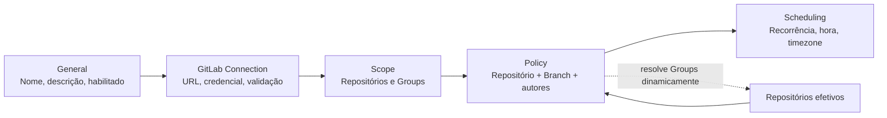
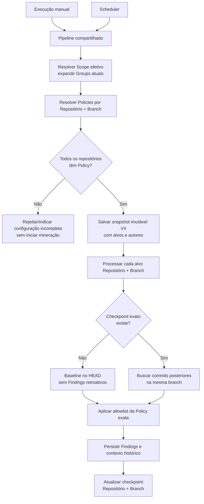
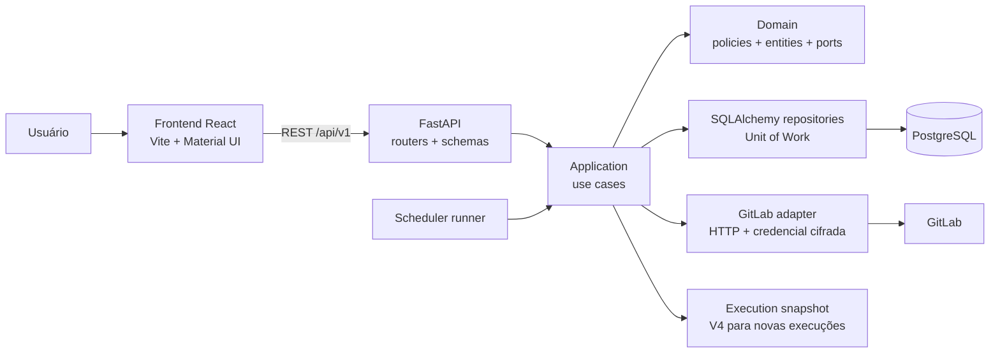

# RepoMiner — visão geral de aplicações, especificações e arquitetura

Este documento reúne uma visão técnica e funcional do repositório: aplicações, módulos, fluxo de mineração, principais decisões de domínio e localização das especificações. Os diagramas Mermaid abaixo são incorporados ao Markdown e são renderizados como diagramas em leitores compatíveis, como GitHub e VS Code com suporte a Mermaid.

> Estado documentado: fluxo aprovado até a Feature 017, incluindo a correção em que Policies são a única fonte de branches de mineração. Para requisitos completos e decisões de cada feature, consulte os arquivos `spec.md` em `specs/`.

## Visão rápida

RepoMiner é uma aplicação web para configurar monitoramentos de repositórios GitLab, executar mineração manual ou agendada e consultar o histórico de execuções e Findings. A regra de Finding atualmente em foco é **Unauthorized Commit Author**. Cada Finding pode oferecer inspeção sob demanda das alterações do commit em um visualizador split Before/After.

| Parte | Tecnologia e responsabilidade |
|---|---|
| Frontend | React, TypeScript, Vite e Material UI; shell, wizard, Scope, Policies, execuções, Findings e diff. |
| Backend/API | Python 3.13+, FastAPI e Pydantic; contratos REST, validação, orquestração e erros Problem Details. |
| Domínio/aplicação | Regras de configuração, resolução de Scope e Policies, snapshots e pipeline compartilhado de mineração. |
| Persistência | PostgreSQL 16, SQLAlchemy 2 e migrações Alembic. |
| Integração | Cliente GitLab HTTP no backend; tokens são protegidos e não são enviados ao frontend após o uso necessário na configuração. |
| Agendamento | Runner no backend; em implantação com múltiplos processos, somente um processo deve executar o scheduler. |

## Aplicações e estrutura do repositório

### Frontend

O frontend é uma SPA React com rotas em `src/app/routes/routeConfig.tsx` e shell em `src/app/layout/`. As funcionalidades ficam organizadas em `src/features/`, com utilitários e acesso HTTP compartilhado em `src/shared/`.

Áreas principais:

- `home`: dashboard com dados reais de execução.
- `monitoring-configurations`: listagem, criação/edição, conexão GitLab, seleção de Scope, Policies por repositório/branch e Scheduling.
- `executions`: histórico e detalhes da execução, incluindo Repositories, Findings e Details.
- `settings`: configurações gerais da interface/aplicação.
- `shared/utils/apiClient.ts`: cliente central que usa `VITE_API_BASE_URL` ou, por padrão, `http://localhost:8000/api/v1`.

O passo exibido ao usuário como **Policy** ainda usa a rota interna `/monitoring-configurations/:id/authors` por compatibilidade. O nome apresentado na interface é Policy.

### Backend

O código do backend está sob `backend/app/` e segue limites inspirados em Clean Architecture:

| Diretório | Papel |
|---|---|
| `api/` | Aplicação FastAPI, dependências, contratos HTTP, schemas e handlers de erro. |
| `application/` | Casos de uso como criação de execução, resolução de Scope/alvos, processamento e consultas. |
| `domain/` | Entidades, políticas, value objects, erros e portas independentes de framework/provedor. |
| `infrastructure/` | Persistência SQLAlchemy, criptografia, clientes GitLab e scheduler. |

As rotas públicas ficam sob `/api/v1`, incluindo monitoramentos, conexão e Scope GitLab, Policies, Scheduling, execuções, repositórios, Findings, dashboard e diff de commit.

## Fluxos principais

### Configurar um monitoramento

O wizard tem cinco passos. **Scope** seleciona diretamente repositórios e/ou Groups dinâmicos; **Policy** resolve os repositórios efetivos e associa um ou mais pares Repositório + Branch a listas de autores permitidos. Não há seletor de branch de mineração em Scope.



As Policies podem conter mais de uma branch para o mesmo repositório. Toda branch configurada cria um alvo independente, com estado de checkpoint e baseline próprio. Um repositório novo descoberto dentro de um Group dinâmico aparece como **Policy required**; nenhum branch é inferido para ele.

### Execução manual ou agendada

Os dois gatilhos usam o mesmo caso de uso de criação/resolução e o mesmo worker. Se qualquer repositório do Scope efetivo não tiver Policy com branch, a execução não começa; o sistema não minera apenas o subconjunto configurado e não usa `default_branch`, `main` ou `master` como fallback.



Branches indisponíveis falham para o alvo correspondente, sem troca por outra branch. A associação a branch do Finding vem do contexto persistido da execução; não se consulta GitLab ao exibir histórico antigo.

### Arquitetura em tempo de execução



O backend é o limite de segurança para credenciais e validação de propriedade do Scope. A API não deve retornar tokens nem incluí-los em logs ou snapshots. GitLab é acessado por adapters de infraestrutura; regras de seleção de alvo e autorização pertencem à aplicação/domínio.

## Regras de domínio importantes

### Scope e Policy

- **Scope** determina quais repositórios pertencem ao monitoramento: repositórios selecionados diretamente e repositórios atuais cobertos por Groups selecionados.
- **Policy** é a única fonte do branch minerado. A Policy também define a allowlist de autores daquela branch.
- Cada repositório atualmente efetivo precisa ter pelo menos uma Policy antes de execução manual ou agendada.
- Membership de Groups é dinâmica. Novos repositórios passam a fazer parte do Scope e exigem Policy antes da próxima execução.
- Policies de Group da Feature 014, por serem branchless, não selecionam alvos nem autorizam commits em novas execuções. Snapshots antigos continuam representando as decisões históricas que capturaram.
- Normalização de email mantém a semântica aprovada: trim, comparação sem distinção de maiúsculas/minúsculas e deduplicação.

### Checkpoints, baseline e histórico

- Chave do checkpoint: configuração + ID estável do repositório + branch.
- Sem checkpoint válido para aquele exato alvo, a primeira execução estabelece baseline no HEAD e não cria Findings retroativos.
- Uma alteração de Policy não reinicia checkpoints nem reclassifica Findings já persistidos.
- Snapshots V4 capturam os alvos efetivos Repositório + Branch e autores da execução. Não incluem credenciais.
- Snapshots históricos anteriores são lidos como histórico; snapshots intermediários pendentes que não definem alvos Policy não podem ser retomados inferindo branch.

### GitLab e credenciais

- Um token GitLab é associado à configuração e cifrado no backend.
- O frontend envia credenciais somente no fluxo necessário para validar/substituir credencial; credenciais salvas nunca são lidas de volta.
- A descoberta de Groups, repositórios e branches usa a conexão associada à configuração.
- Listagem de branches e mutações de Policy validam no servidor que o repositório pertence ao Scope efetivo.

### Scheduling

Scheduling preserva recorrência diária/semanal/mensal, hora local, timezone IANA, preview de próxima ocorrência e tratamento DST já definidos. O agendamento não muda a regra de mineração: usa o mesmo resolver/pipeline da execução manual.

### Findings e diff

- A categoria implementada aqui é Unauthorized Commit Author; não se deve inferir categorias não existentes.
- Finding mantém vínculo a commit, autor, RepositoryExecution e branch histórica.
- O diff é obtido sob demanda da integração GitLab. O visualizador split alinha cada linha lógica horizontalmente em uma única linha visual, mantendo números de linha independentes, estados binário/truncado/limite e estados de loading/error/retry.

## Especificações do produto

As specs numeradas são a fonte de requisitos e decisões por feature. Esta tabela é um índice resumido; não substitui `spec.md`, decisões de clarification, `plan.md`, `contracts/` ou `tasks.md`.

| Feature | Tema | Responsabilidade principal |
|---|---|---|
| 001 | Application Shell | Shell e navegação inicial da aplicação. |
| 002 | Monitoring Configuration CRUD | Criar, consultar, editar e administrar monitoramentos. |
| 003 | GitLab Connection | Conexão, validação e proteção das credenciais GitLab. |
| 004 | GitLab Scope Selection | Árvore GitLab e seleção direta/dinâmica de Groups e repositórios. |
| 005 | Scheduling Configuration | Modelo e edição de recorrência, timezone e preview. |
| 006 | Execution Model and History | Ciclo de vida, snapshots e histórico de execuções. |
| 007 | Execution Dashboard | Detalhes, abas e apresentação dos dados de execução. |
| 008 | Repository Mining Engine | Pipeline de mineração e isolamento por repositório. |
| 009 | Scheduled Execution | Disparo recorrente e integração ao pipeline compartilhado. |
| 010 | Mining Findings | Regra Unauthorized Commit Author e Findings persistidos. |
| 011 | Finding Commit Diff Details | Metadados e consulta sob demanda do diff do commit. |
| 012 | Split Diff Viewer | Comparação Before/After lado a lado, sincronizada por linha. |
| 013 | RepoMiner Visual & UX Alignment | Linguagem visual, shell, tabelas, wizard e apresentação geral. |
| 014 | Repository & Branch Author Policies | Allowlist por repositório/branch e Policies de Group (compatibilidade histórica). |
| 015 | Monitoring Configuration Wizard Flow Consolidation | Ownership de campos e fluxo único de cinco passos com navegação inferior fixa. |
| 016 | Monitoring Configuration Final UX Adjustments | Ação manual na lista, Selected Scope sticky e retorno à lista ao salvar. |
| 017 | Repository Branch Mining Selection | A branch da Policy é também o alvo de mineração; Scope não define branches. |

Diretório de cada feature: `specs/NNN-nome/`. Artefatos usuais incluem `spec.md`, `plan.md`, `tasks.md`, `research.md`, `data-model.md`, `quickstart.md`, contratos e checklists, conforme a feature.

## Endpoints e contratos por área

Os routers são registrados em `backend/app/api/main.py` com prefixo `/api/v1`. As rotas exatas e schemas ficam em `backend/app/api/v1/` e devem ser consultados antes de integrar um novo cliente.

| Área | Módulo de rota |
|---|---|
| Monitoramentos | `monitoring_configurations.py` |
| GitLab connection/candidate validation | `gitlab_connections.py` |
| Scope e descoberta hierárquica | `gitlab_scopes.py` |
| Policies e branches | `author_policies.py` |
| Schedule/timezone/preview | `monitoring_schedules.py` |
| Execuções manuais e histórico | `executions.py` |
| Resultado por repositório | `repository_executions.py` |
| Findings e commit diff | `findings.py` |
| Home dashboard | `dashboard.py` |

Handlers convertem erros de domínio e validação para o formato seguro da API. A maioria das mutações condicionais usa `ETag`/`If-Match`; execuções também aceitam chave de idempotência onde previsto pelo contrato.

## Testes e execução local

O arquivo `.env.example` mostra os nomes das variáveis de ambiente. Crie/edite `.env` local, que é ignorado pelo Git. **Não copie tokens, chaves Fernet ou senhas para documentação ou commits.**

### Stack de serviços

`compose.yaml` inicia PostgreSQL e backend; o frontend roda separadamente com Vite:

```powershell
docker compose up --build
```

Em outro terminal, na raiz:

```powershell
npm install
npm run dev
```

Endereços de desenvolvimento previstos:

- Frontend: `http://localhost:5173`
- Backend: `http://localhost:8000`
- Health: `http://localhost:8000/health`
- API: `http://localhost:8000/api/v1`

Para testes backend, entre em `backend/` e configure `TEST_DATABASE_URL` para PostgreSQL conforme o padrão do projeto. Testes que dependem de banco devem usar PostgreSQL, não SQLite. Para execução de API sem scheduler durante testes, use `SCHEDULER_ENABLED=false`. Em produção/múltiplos workers, somente um processo deve ter scheduler habilitado.

Comandos comuns:

```powershell
# Frontend, raiz do repositório
npm run test:run
npm run build

# Backend, diretório backend (com ambiente virtual e TEST_DATABASE_URL configurados)
python -m pytest tests -q
```

## Onde buscar detalhes

- Princípios arquiteturais e de segurança: `.specify/memory/constitution.md`.
- Setup GitLab/credenciais: `specs/003-gitlab-connection/quickstart.md` e `README.md`.
- Pipeline de mineração: `specs/008-repository-mining-engine/` e `specs/017-repository-branch-mining-selection/`.
- Scheduling: `specs/005-scheduling-configuration/` e `specs/009-scheduled-execution/`.
- Author Policies e snapshot histórico: `specs/014-repository-branch-author-policies/` e Feature 017.
- Finding/diff: `specs/010-mining-findings/`, `specs/011-finding-commit-diff-details/` e `specs/012-split-diff-viewer/`.
- Decisões recentes de UX: Features 013–016.

